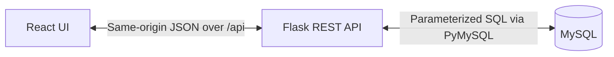

# TaskFlow build and operations guide

TaskFlow runs locally as a React dashboard backed by a custom Flask REST API and MySQL. Users register or sign in before reaching the dashboard. Each account starts with an empty task list, and MySQL stores the tasks that account creates.

[Open TaskFlow on localhost](http://127.0.0.1:3000)

## How the app evolved

1. **Reviewed the original app.** The React/Vite frontend used Express and a JSON task file. A clean install failed because Vite and the direct esbuild dependency expected different versions. On Windows, the startup guard compared a file URL pathname with a filesystem path and skipped server startup.
2. **Fixed the original runtime.** Removed the unused direct esbuild dependency, used a Windows-safe file URL conversion, updated the Vite configuration, and added a repeatable test command. The legacy store gained a regression test to protect corrupt task files from being overwritten.
3. **Connected Flask and MySQL.** Implemented the task REST API in Python while keeping the request and response format the React UI already used. Docker Compose provisions MySQL with a persistent volume. The first integration imported five sample tasks to verify the move from JSON.
4. **Added accounts and empty dashboards.** Removed the JSON import from the active initialization flow. Added account creation, sign-in, session restore, and sign-out. Scoped every task read and write to the authenticated account. Previously imported rows remain unassigned in an upgraded database and are excluded from every dashboard.

## Architecture



Flask serves the built React app at `/`, `/login`, and `/dashboard`. During frontend development, Vite serves the UI and proxies `/api` to Flask. The browser sends a session cookie with same-origin requests. Flask resolves the session to a user and uses that user’s ID when querying tasks.

| File | Responsibility |
| --- | --- |
| [src/components/AccountGate.tsx](src/components/AccountGate.tsx) | Login and registration forms, session restore, dashboard routing, and sign-out |
| [src/App.tsx](src/App.tsx) and [src/services/taskService.ts](src/services/taskService.ts) | Task interactions and calls to the REST API |
| [backend/app.py](backend/app.py) and [backend/auth.py](backend/auth.py) | Flask routes, input validation, authentication, and task ownership checks |
| [backend/database.py](backend/database.py) and [backend/schema.sql](backend/schema.sql) | MySQL connections, transactions, schema setup, and migration |
| [compose.yaml](compose.yaml) and [vite.config.ts](vite.config.ts) | Local MySQL service and Vite API proxy |

## Account and task flow

1. On page load, React calls `GET /api/auth/session`. A valid session opens `/dashboard`. Otherwise, React shows `/login`.
2. Registration stores an email and a password hash in `users`. Login verifies the password against its hash. Both issue an opaque token in an HTTP-only cookie and store the token’s hash, owner, and expiration in `login_sessions`.
3. **Keep me signed in** gives the cookie and server-side session a 30-day lifetime. With the option cleared, the browser receives a session cookie and Flask enforces a 12-hour expiration.
4. The dashboard loads `GET /api/tasks`. Each task row carries a `user_id`. Flask filters reads, edits, toggles, deletions, and reordering by the signed-in user. Task writes run in MySQL transactions.
5. Signing out deletes the current session record and clears the cookie. When the task API returns `401` for an expired session, React returns to the sign-in screen.

## Run locally on Windows

From the TaskFlow folder in PowerShell, install the dependencies with Node.js, Python, and Docker Desktop available.

```powershell
npm install
python -m venv .venv
.venv/Scripts/python.exe -m pip install -r requirements.txt
```

If `.env` is missing, copy `.env.example` to `.env` and set a strong local `MYSQL_PASSWORD`. Match `MYSQL_PORT`, `MYSQL_DATABASE`, and `MYSQL_USER` to the running MySQL service. Docker uses the database credentials from `.env` when it initializes a new volume.

```powershell
docker compose up -d mysql
.venv/Scripts/python.exe -m flask --app backend.app init-db
npm run build
.venv/Scripts/python.exe -m backend.app
```

Open [TaskFlow](http://127.0.0.1:3000) and choose **Create an account**. For frontend development, keep Flask running and run `npm run dev` in a second terminal. Open the address Vite prints. If Flask uses a different port, set `TASKFLOW_API_PROXY` in the Vite terminal. Use the same browser hostname consistently because the session cookie is bound to that hostname.

If MySQL is still starting, rerun `init-db` when it is ready. On existing installations, run `init-db` before restarting Flask so the account tables and task ownership column are available. If the configured MySQL host port is occupied, choose a free port in `.env` before starting Compose. If Flask is already running when its Python code changes, restart that Flask process and reload the browser.

## REST API

| Method | Path | Purpose |
| --- | --- | --- |
| GET | `/api/health` | Check that Flask can query MySQL |
| GET | `/api/auth/session` | Return the current user or `null` |
| POST | `/api/auth/register` | Create an account and sign in |
| POST | `/api/auth/login` | Verify credentials and start a session |
| POST | `/api/auth/logout` | End the current session |
| GET | `/api/tasks` | List owned tasks. Use `?status=active` or `?status=done` to filter |
| POST | `/api/tasks` | Create a task from a JSON body containing `title` |
| PUT | `/api/tasks/<id>` | Update a task’s details |
| PATCH | `/api/tasks/<id>/toggle` | Toggle completion |
| PATCH | `/api/tasks/reorder` | Apply the order in the JSON `orderedIds` array |
| DELETE | `/api/tasks/<id>` | Delete an owned task |

## Verification

- `npm run build`, `npm run lint`, and all 13 tests passed. The Node test suite covers frontend task logic and the legacy JSON store.
- Flask served the React HTML and built bundle. The health API successfully queried MySQL.
- Live API checks covered registration, sign-in with correct and incorrect passwords, session restore, the persistent cookie, logout, and empty task lists for new accounts.
- A task created with one account was visible to that account after signing back in. The second account could neither see it nor edit, toggle, delete, or reorder it.
- The login screen and dashboard routes returned the React app. Browser interactions were not exercised in the live API checks.

## Local operating scope

The current launcher runs Flask’s local development server. MySQL persists its data in the Compose volume. Local configuration belongs in the ignored `.env` file. For HTTPS behind a proxy, Flask supports `SESSION_COOKIE_SECURE=1`; the proxy configuration must preserve the correct browser origin for API writes.
